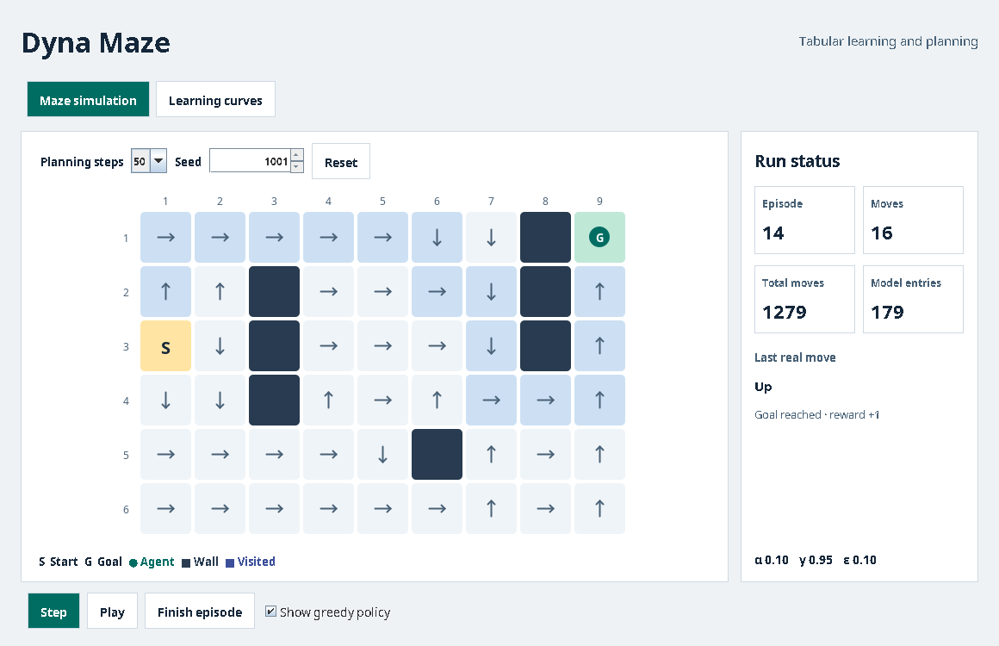
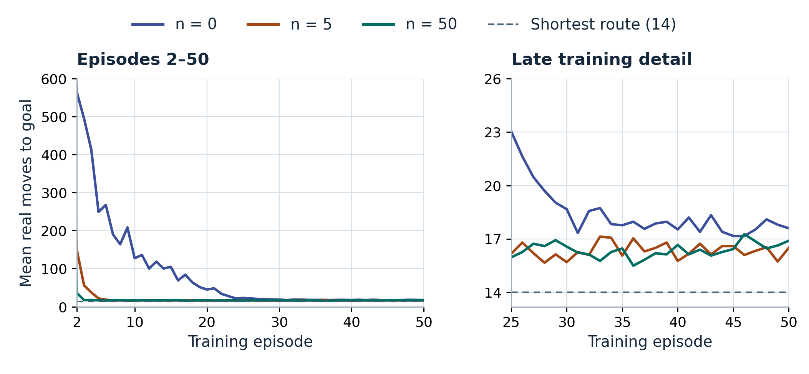

# Dyna Maze

Dyna Maze is a Java Swing simulator for comparing tabular Dyna-Q with direct Q-learning. Adjust the planning budget, watch the agent learn a route, and reproduce the learning curves with the same seeds.

## Run the simulator

Use JDK 17 or later. The desktop application uses the Java standard library and runs in a graphical session.

In Windows CMD, run from the repository root.

~~~cmd
run.cmd
~~~

To build and run directly from a terminal, use the same Java entry point.

~~~text
javac --release 17 -encoding UTF-8 -d out -sourcepath src src/dynamaze/DynaMazeApp.java
java -cp out dynamaze.DynaMazeApp
~~~

Choose **0**, **5**, or **50** planning updates per real move. Use **Step** for one move, **Play** to animate the agent, or **Finish episode** to advance to the goal. **Show greedy policy** displays the agent's current action preferences. In **Learning curves**, click **Run comparison** to repeat all three settings.

## Environment and algorithm

The agent navigates a deterministic 6 × 9 maze with seven walls and 47 reachable cells. It can move in four directions. A blocked move leaves the agent in the same cell and counts as a real move. Entering the goal gives a reward of +1 and ends the episode. Each new episode starts at S. Other transitions have reward 0.

On each real transition the agent updates its Q-table. With planning enabled, it stores the observed next state, reward, and terminal flag for the state–action pair. Each additional update samples a previously observed state and an action taken there, then uses the stored outcome to update the same Q-table. A planning budget of 0 gives the direct Q-learning baseline.

## Experiment and results

Each setting runs 50 episodes for each of 30 matched behavior seeds (1001–1030). The learning rate is 0.10, the discount factor is 0.95, and the exploration rate is 0.10. Q-values start at zero. Each seed follows the same first-episode path across the three settings, so the comparison graph starts at episode 2.

| Planning updates per real move | Mean moves in episode 2 | Mean moves per episode, episodes 41–50 | Mean Q-value updates per run | Final 14-move greedy paths |
| ---: | ---: | ---: | ---: | ---: |
| 0 | 564.0 | 17.67 | 5,145 | 15/30 |
| 5 | 148.9 | 16.34 | 11,911 | 25/30 |
| 50 | 36.1 | 16.54 | 92,262 | 24/30 |

Fifty planning updates produce the largest early reduction in real moves. Five and fifty planning updates have similar late-training move counts, and the fifty-update setting performs about 7.7 times as many Q-value updates per run. Breadth-first search on the maze gives the 14-move reference. Final greedy paths are evaluated with exploration turned off.

## Reproduce the results

In Windows CMD, run the batch experiment from the repository root.

~~~cmd
run.cmd --experiment rerun
~~~

With the classes already built, the equivalent command is `java -cp out dynamaze.DynaMazeApp --experiment rerun`. Batch mode runs without opening the desktop window. The command writes three CSV files to the specified directory.

| Checked-in file | Contents |
| --- | --- |
| [learning_curves.csv](results/learning_curves.csv) | Mean real moves to the goal by episode and planning budget |
| [runs.csv](results/runs.csv) | All 4,500 episode lengths with planning budget, run, seed, and episode |
| [greedy_routes.csv](results/greedy_routes.csv) | Final greedy route lengths for all 90 runs |

## Project structure

| Java class | Responsibility |
| --- | --- |
| [DynaMazeApp](src/dynamaze/DynaMazeApp.java) | Opens the Swing application or runs the batch experiment |
| [Maze](src/dynamaze/Maze.java) | Defines the grid, transitions, rewards, and breadth-first search reference |
| [DynaQAgent](src/dynamaze/DynaQAgent.java) | Selects actions, learns the transition model, and updates the Q-table |
| [Experiment](src/dynamaze/Experiment.java) | Runs the matched-seed comparison and writes CSV results |
| [MazeWorkspace](src/dynamaze/MazeWorkspace.java) | Connects the simulation controls, animation, and comparison view |

## Reference

The maze and algorithm follow Example 8.1 in Sutton and Barto, *Reinforcement Learning: An Introduction*, 2nd edition, Chapter 8. [MIT Press](https://mitpress.mit.edu/9780262039246/reinforcement-learning/)
